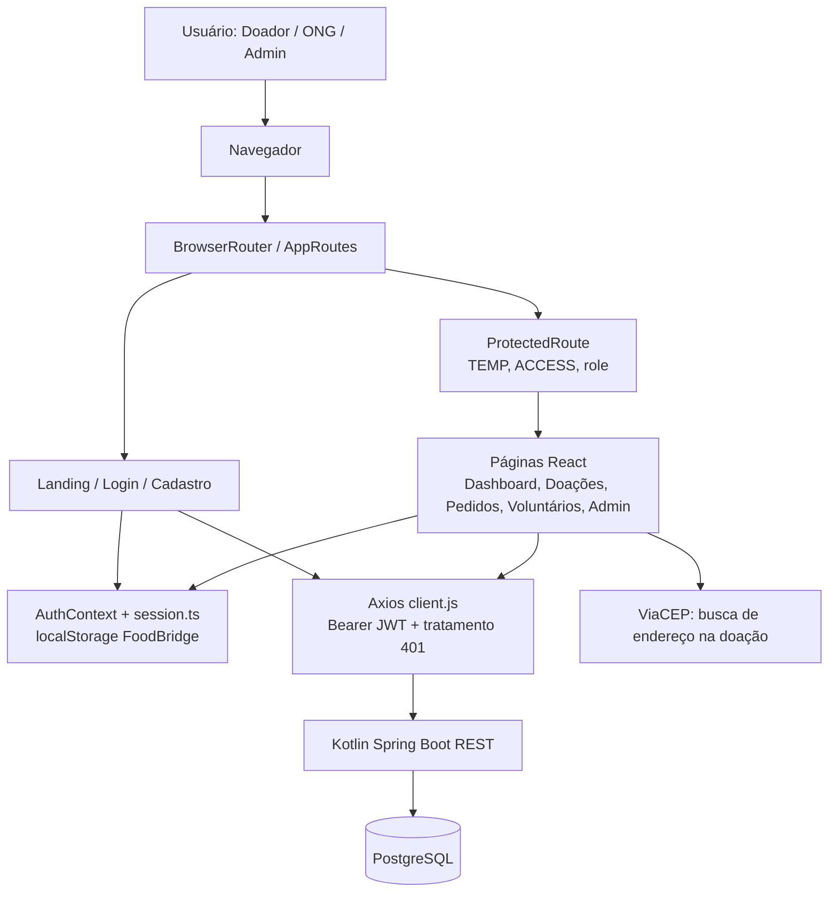
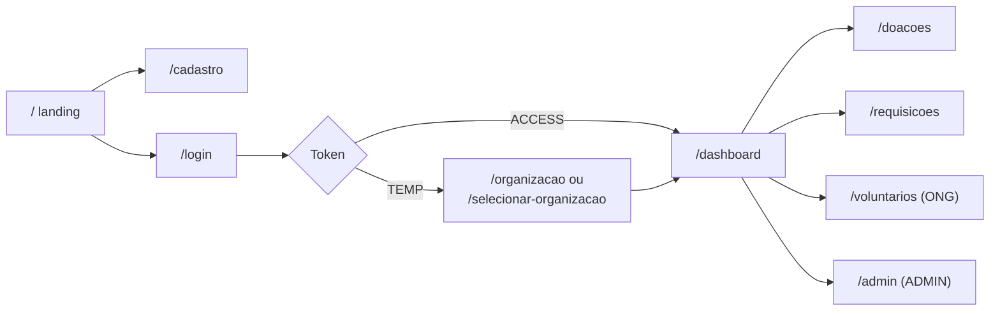

# FoodBridge Web — arquitetura React atual

> **FB-WEB-ARC-001 · 13/11/2026.** Diagrama baseado em `src/`, rotas, dependências e workflows verificados. A API Kotlin permanece em um repositório independente.

## Visão de componentes

O código usa arquivos `.tsx`, `.jsx`, `.ts` e `.js`. A documentação preserva os nomes reais dos arquivos, em vez de declarar que todo o projeto está 100% em TypeScript.

## Arquitetura de navegação

A UI armazena somente as chaves de sessão da própria aplicação, impede reutilizar contexto incorreto de organização, expira JWT pela claim `exp` e limpa a sessão em HTTP 401. A decodificação de JWT no browser **não comprova assinatura**; a API valida o token e os vínculos.

## Integração HTTP e ambiente

- `src/api/client.js`: Axios com `baseURL: import.meta.env.VITE_API_BASE_URL || ""` e timeout 30s; injeta Bearer da sessão se não houver Authorization explícito.
- `src/hooks/usePublicDashboard.js`: consulta `/dashboards/publico` com AbortController e tratamento de erro.
- `src/pages/Register.tsx`: usa `fetch("/usuarios")`, fora do cliente Axios compartilhado. É uma dívida técnica porque depende do mesmo origin/roteamento do Nginx.
- `src/pages/Donations.jsx`: consulta ViaCEP externo na digitação de CEP; requer tratamento de privacidade e disponibilidade da API de terceiro.
- Nginx serve `dist`; a configuração pública de proxy da API precisa coincidir com a baseURL do build. O código não confirma por si só que todas as rotas do backend estão expostas por reverse proxy.

## Deploy React

```mermaid
flowchart LR
    PR["PR → CI\ntestes + lint + build"] --> MERGE["Merge main"]
    MERGE --> GH["GitHub Actions deploy.yml"]
    GH --> TESTS["npm ci, test:session, lint, build"]
    TESTS --> SSH["SSH RSA / known_hosts + SHA256"]
    SSH --> TAR["Pacote dist → Oracle Linux"]
    TAR --> BACKUP["Backup dist antigo"]
    BACKUP --> RESTORE["Novo dist 0755/0644 + restorecon"]
    RESTORE --> NGINX["nginx -t + HTTP local 200"]
    NGINX --> EXT["HTTP externo observado + run SUCCESS"]
```

`deploy.yml` roda automaticamente em pushes de código na main; alterações exclusivamente em documentação não publicam. O runner valida o host pinado e envia a compilação. A VM valida o pacote, aplica permissões públicas **somente ao conteúdo estático**, guarda backup e tenta rollback se a publicação falhar.

Houve incidente real HTTP 403 por `mktemp`/`umask 077` no diretório `dist`. Corrigido no [PR #11](https://github.com/DanieldeAlmeida2024/Foodbridge-Frontend-React/pull/11) e homologado com HTTP 200 [run #43465805656](https://github.com/DanieldeAlmeida2024/Foodbridge-Frontend-React/actions/runs/43465805656).

## Decisões e riscos

A UI é uma SPA; alterações de estado e guards não substituem autorização no servidor. Tokens no localStorage tornam XSS uma preocupação relevante. A plataforma armazena informações de voluntários, incluindo CPF e endereço no backend; validar minimização de exposição nas telas. Testes de navegador completo, acessibilidade, HTTPS 443, observabilidade e estratégia de backup do PostgreSQL não foram homologados pelo CI do frontend.

Referência: [páginas e operações](RECURSOS_E_TELAS.md), [documentação da API](https://github.com/DanieldeAlmeida2024/FoodBridge-API-Kotlin/blob/main/docs/REFERENCIA_API_ATUAL.md), [UML frontend](uml/README.md).
